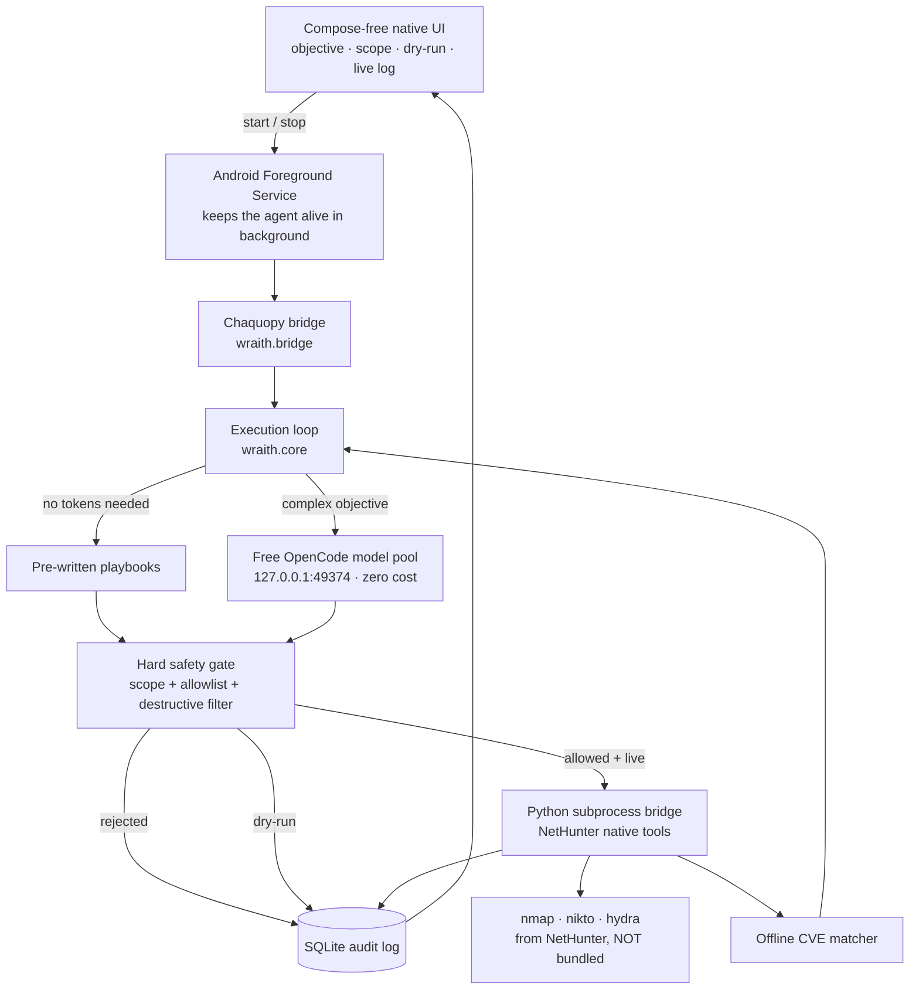

# Wraith
WARNING: This tool is strictly for authorized security testing. You must only use it within the scope of systems you own or have explicit, written permission to test. Unauthorized use is illegal and strictly prohibited.
**Wraith** is a standalone autonomous penetration-testing agent shipped as a native Android APK.
It is built for **rooted Kali NetHunter devices** and embeds **Python 3.11** through Chaquopy,
so it runs **without Termux** and without installing any toolchain on the phone.

> **Authorized use only.** Wraith is a security-testing tool for networks and hosts you own or
> have explicit written permission to test. The safety layer is hard-coded: nothing leaves the
> configured scope, and destructive commands are rejected before execution.

## Architecture



Execution loop:

1. Read scope from YAML (`allowed:` list of IPs / CIDRs).
2. Ask the free OpenCode model for the next command — **or** use a pre-written playbook when one
   matches (zero LLM tokens).
3. Validate: target inside scope, tool in allowlist, no shell operators, no destructive patterns.
4. If **dry-run** is ON (default), preview the command on screen and execute nothing.
5. Otherwise run it through a plain `subprocess` call with `shell=False` and audit the output.
6. Match output against the offline CVE database, feed a compressed history back to the model,
   repeat until done or the step limit is reached.

## Hard safety controls

| Control | Where | Behaviour |
| --- | --- | --- |
| Scope validation | `wraith/scope.py`, `validator.py` | Only literal IPs inside configured CIDRs pass. External targets are rejected. |
| Command allowlist | `wraith/validator.py` | Only `nmap`, `nikto`, `hydra`. |
| Destructive filter | `wraith/validator.py` | Blocks `rm -rf`, `mkfs`, `dd`, `sudo`, `su`, pipes, redirects, command substitution, shells. |
| No shell injection | `wraith/core.py` | `subprocess.run(argv, shell=False)`. |
| Dry-run | UI toggle, default ON | Commands are shown but never executed. |
| Audit | `wraith/audit.py` | Every command, decision and output is written to local SQLite. |

## Token efficiency

- **Dynamic tool pruning** (`tools.py`) — only the schemas relevant to the current step are sent.
- **History compression** (`history.py`) — older steps are summarized, recent steps kept verbatim.
- **Local CVE matching** (`cve.py`) — known banners are handled offline, no model call.
- **Pre-written playbooks** (`playbooks.py`) — common chains skip LLM reasoning entirely.

## Build

Requirements: Linux, JDK 17+, Android SDK 34, Gradle 8.9, Python 3.11 for Chaquopy's build step.

```sh
export JAVA_HOME=/usr/lib/jvm/java-21-openjdk-arm64
export ANDROID_HOME=/opt/android-sdk
/opt/gradle-8.9/bin/gradle :app:assembleDebug --no-daemon
```

Output: `app/build/outputs/apk/debug/app-debug.apk`

Python unit tests:

```sh
PYTHONPATH=app/src/main/python python3.11 -m unittest discover -s tests -v
```

## Runtime layout

- APK package: `com.wraith.agent`
- Internal files: `scope.yaml`, `wraith.log`, `wraith_audit.db`
- LLM endpoint: `http://127.0.0.1:49374` (OpenCode server already running on the device)
- Default free model: `opencode/big-pickle`
- Tools are **not** bundled — Wraith calls NetHunter's own `nmap`, `nikto`, `hydra` binaries
  through the subprocess bridge.

## Legal

Use only on systems you are authorized to test. The authors assume no liability for misuse.
Licensed under the MIT License — see [LICENSE](LICENSE).
